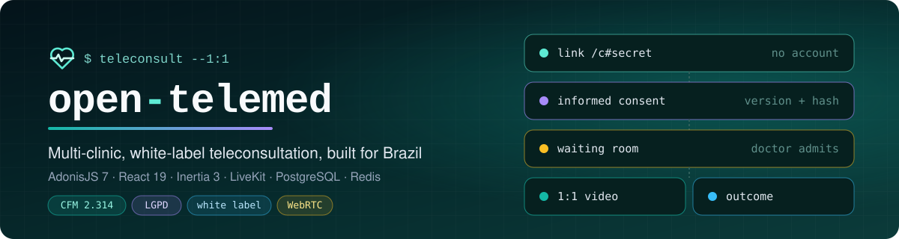
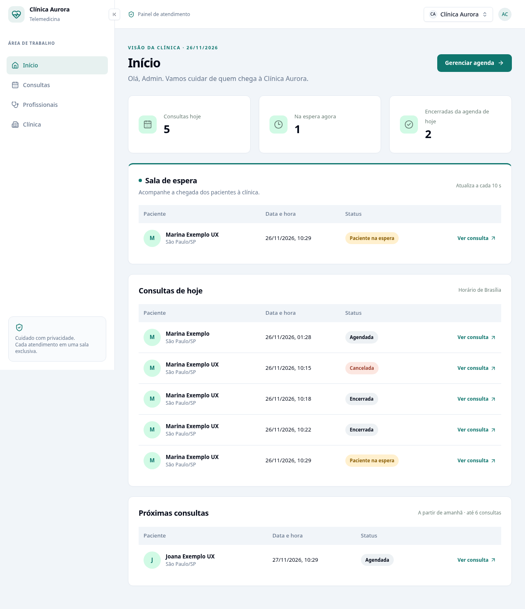
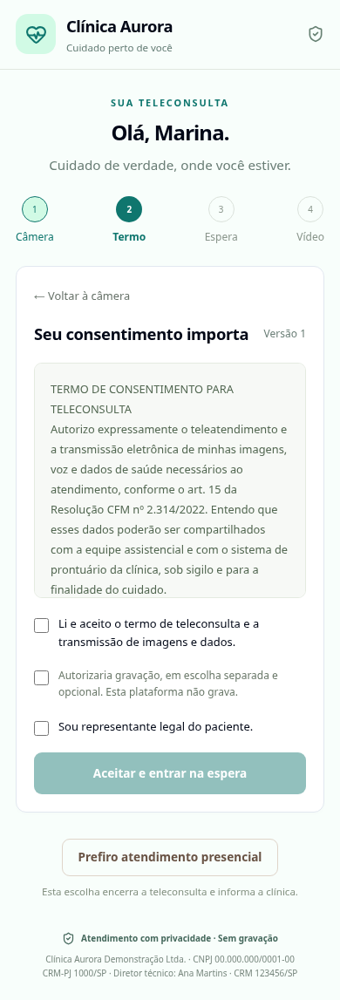
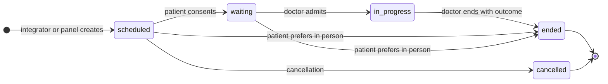
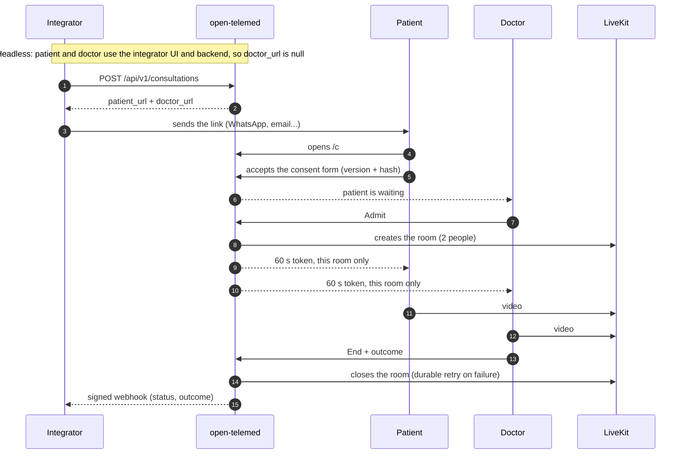

<div align="center">



<p>
  <a href="https://nodejs.org/"></a>
  <a href="https://adonisjs.com/"></a>
  <a href="https://react.dev/"></a>
  <a href="https://inertiajs.com/"></a>
  <a href="https://livekit.io/"></a>
  <a href="https://www.typescriptlang.org/"></a>
  <a href="https://tailwindcss.com/"></a>
  <a href="package.json"></a>
  <a href="#license"></a>
</p>

**English** · [Português](README.pt.md)

---

_"The patient taps the link, accepts the consent form and waits. The doctor admits. The rest is the appointment."_

<table>
  <tr>
    <td width="72%" valign="top"></td>
    <td width="28%" valign="top"></td>
  </tr>
</table>

</div>

---

> [!IMPORTANT]
> **`open-telemed` is a 1:1 teleconsultation platform: multi-clinic and white label.**
> Each clinic has its own brand, domain and legal details. The patient joins through a link **without creating an
> account**: they test camera and microphone, accept a versioned consent form, wait in the waiting room and only join the
> video once the doctor admits them. The flow follows Brazil's **Resolução CFM 2.314/2022** (Federal Council of
> Medicine telemedicine rules), **Lei 14.510/2022** (telehealth law) and the **LGPD** (data protection law). Video runs
> on **LiveKit**, self-hosted or Cloud, with no clinical data going through it. **Pre-1.0** (`0.1.0`).

---

## Overview

open-telemed is not an electronic health record. It does one thing well, the teleconsultation room, and hands the
record to the clinic's own system through an API and webhooks. In headless mode, the integrator owns both interfaces
and calls the engine through its backend; the open-telemed panel stays for platform operations.

<table>
  <tr>
    <td width="33%" valign="top"><h3>🎥 1:1 video on LiveKit</h3>One room per appointment, two people at most, prefixed with the clinic. Initial tokens last 60 s and open only that room. Metadata carries only the role, and ending schedules room closure with recovery on failure.</td>
    <td width="33%" valign="top"><h3>🏥 Multi-clinic and white label</h3>The clinic is resolved from the <code>Host</code> and its own domains: its logo, colors (video included) and title. The footer shows legal name, CNPJ, CRM-PJ and medical director.</td>
    <td width="33%" valign="top"><h3>📝 Consent the way CFM requires</h3>An immutable consent text, versioned per clinic. Acceptance stores version, hash, timestamp, IP, user agent and legal guardian. Recording is a separate choice and is off by default.</td>
  </tr>
  <tr>
    <td valign="top"><h3>🔒 Medical confidentiality</h3>Only the appointment's own doctor can admit, get a video token and end it, not even the clinic owner. The patient gets no token before consenting and being admitted.</td>
    <td valign="top"><h3>🔌 API and webhooks</h3>An integrator creates, reads, cancels and audits appointments with a service token. Every status change goes out as an HMAC-SHA256 signed webhook, with retries.</td>
    <td valign="top"><h3>🧪 Tested end to end</h3>Japa suites (unit, functional and browser) against real PostgreSQL and Redis. Two real video sessions with fake cameras. Vitest on the frontend and OpenAPI assertions.</td>
  </tr>
</table>

| Property     | Value                                                                            |
| :----------- | :------------------------------------------------------------------------------- |
| **Package**  | `open-telemed` `0.1.0`                                                           |
| **Runtime**  | Node.js 24 LTS (`.nvmrc`), pnpm 11 (`packageManager`)                            |
| **Backend**  | AdonisJS 7, Lucid, VineJS, Bull Queue, `livekit-server-sdk`                      |
| **Frontend** | React 19, Inertia 3, Tailwind CSS 4, `@livekit/components-react`                 |
| **Video**    | LiveKit SFU 1.13 (self-hosted) or LiveKit Cloud, WebRTC                          |
| **Data**     | PostgreSQL and Redis (cache, rate limiting and queue)                            |
| **API**      | Redoc at `/docs`, spec in [`docs/openapi.yaml`](docs/openapi.yaml)               |
| **Base**     | [adonis-web-kit](https://github.com/gabrielmaialva33/adonis-web-kit): auth, N:N tenants, RBAC, audit log |
| **Rules**    | [`docs/brazil-telemedicine-rules.md`](docs/brazil-telemedicine-rules.md)         |

### Life of an appointment



The outcome is one of `completed`, `referred_in_person`, `patient_declined` or `no_show`. Every transition goes to the
append-only audit trail and fires the integrator's webhook.

### Who does what



## Quick start

```bash
# 1. Install (Node.js 24 LTS and pnpm 11)
pnpm install
# 2. Environment and application key
cp .env.example .env && pnpm ace generate:key
# 3. PostgreSQL, Redis, Mailpit and LiveKit
docker compose up -d postgres redis mailpit livekit
docker compose exec -T postgres createdb -U postgres open_telemed_test
# 4. Schema, two sample clinics and the dev server with HMR
pnpm ace migration:run && pnpm ace db:seed
pnpm dev
```

The app answers on `http://localhost:3333` and Mailpit shows outgoing email on `http://localhost:8026`. The Compose ports
are PostgreSQL `5434`, Redis `6381`, SMTP `1026` and LiveKit `7880`/`7881`/`7882-udp`, so they do not clash with other
projects on the same machine.

The seed creates two fictional clinics, **Aurora** (green) and **Horizonte** (purple), each with an admin, a doctor, a
service user and one appointment. It prints the logins, patient links and integration tokens. The demo password is
`TelemedDemo2026!` and the doctors are `medico@aurora.example.test` and `medico@horizonte.example.test`.

> [!NOTE]
> LiveKit must advertise an IP the browser can reach. If Docker runs on another machine, point `LIVEKIT_NODE_IP` and
> `LIVEKIT_URL` in `.env` at it. Browsers only open the camera in a secure context: `localhost` works in development,
> anything else needs HTTPS.

> [!WARNING]
> Until `1.0`, migrations describe a clean install. A schema change goes into its original `create_*` migration and you
> recreate the dev and test databases with `pnpm ace migration:fresh --force`.

## Architecture

The backend is organized **by domain**. Each module lives in `app/modules/<domain>/`, follows controller → service →
repository → model and registers its own `routes.ts`.

| Module                                  | Owns                                                                         |
| :-------------------------------------- | :--------------------------------------------------------------------------- |
| `consultations`                         | Appointment, patient link, doctor room, integrator API and webhooks          |
| `headless`                              | Delegated doctor authorization, patient API and trusted integration mappings |
| `consents`                              | Versioned consent texts and acceptances                                      |
| `professionals`                         | Professional profile (CRM, UF and RQE) and clinic settings                   |
| `tenants`                               | Clinic: brand, domains, legal details and public resolution from `Host`      |
| `audits`                                | Append-only audit trail                                                      |
| `auth`, `users`, `roles`, `permissions` | Accounts, JWT, RBAC and ownership checks (from the kit)                      |
| `web`                                   | Inertia pages for the panel and the patient                                  |

Video lives in `app/shared/services/video_service.ts`. Imports use the `#modules/*` and `#shared/*` aliases, never
`../../`.

### Roles

| Role           | Can                                                                                                                                         |
| :------------- | :------------------------------------------------------------------------------------------------------------------------------------------ |
| `clinic_owner` | Configure brand, legal details, consent text and webhook. Register professionals and appointments. See the whole clinic, but **not attend** |
| `doctor`       | See and attend **their own** appointments: admit, join the video and end                                                                    |
| `integrator`   | Use the API to create, read, cancel and audit appointments, and carry headless requests; a service token alone **cannot attend**            |

## Brazilian rules → product

| Rule                         | What open-telemed does                                                                                          |
| :--------------------------- | :-------------------------------------------------------------------------------------------------------------- |
| CFM 2.314/2022, art. 15      | Explicit, versioned, hashed consent. No acceptance, no video                                                    |
| CFM 2.314/2022, art. 4 and 6 | The consent text states there is no physical exam. "Prefer in person" button and a "referred in person" outcome |
| CFM 2.314/2022, art. 17      | Each clinic stores CNPJ, CRM-PJ and medical director, shown on the patient page                                 |
| Lei 14.510/2022, art. 26-H   | Does not block doctors registered in another state                                                              |
| Lei 13.787/2018              | `retain_until` with a 20-year minimum (`CLINICAL_RETENTION_YEARS`)                                              |
| LGPD, art. 11                | Minimization: LiveKit only sees the first name and role, logs carry no CPF, tenants are isolated                |

The full research, with sources, is in [`docs/brazil-telemedicine-rules.md`](docs/brazil-telemedicine-rules.md).
This is not legal advice: a healthcare lawyer reviews it before production.

## Integrator API

Authenticate with `Authorization: Bearer <service token>`, the API token of a clinic service user. A resource from
another clinic answers **404**. Send the mapped `X-Tenant-Id`; membership and token abilities are checked.

| Route                                   | Does                                               |
| :-------------------------------------- | :------------------------------------------------- |
| `POST /api/v1/consultations`            | Creates and returns `patient_url` and `doctor_url` |
| `GET /api/v1/consultations/:id`         | Record with fields that map to the RNDS RAC        |
| `POST /api/v1/consultations/:id/cancel` | Cancels before the appointment starts              |
| `GET /api/v1/consultations/:id/audit`   | Audit trail                                        |

The GET record includes `professional_snapshot` (doctor identity frozen at admission or an explicit no-show decision)
and `outcome_author` (doctor, patient or system attribution). It is an attributed encounter export, not a digitally signed
clinical document. `video_closure` separately reports pending/completed closure, mode, attempts and `tokens_revoked`;
clinical completion does not prove media revocation.

The full list and payloads are in [`docs/openapi.yaml`](docs/openapi.yaml) and at `/docs`.

**Webhooks.** Every status change goes out as a JSON POST signed with HMAC-SHA256 (`X-OpenTelemed-Signature`), with up
to 6 attempts and exponential backoff. Verify it over **`X-OpenTelemed-Timestamp + '.' + raw body`**, check the timestamp
within ±300 seconds and deduplicate by `event_id` (`id` is its legacy alias). Reconcile out-of-order events by consultation
`revision`. Delivery runs on the queue:

```bash
pnpm ace queue:listen --queue=consultation-webhooks
pnpm ace telemed:dispatch-webhooks   # recovers events that never reached the queue (schedule it)
```

LiveKit reports joins and leaves to `POST /webhooks/livekit`, verified with its `WebhookReceiver`.

### Headless mode

Clínica Fácil or another integrator renders the doctor and patient flows **in its own interface and domain**, without
an open-telemed login or brand. Its backend-for-frontend (BFF) calls these APIs; the doctor keeps the integrator's login,
and the patient still needs no account. The engine endpoints are implemented; the integrator builds its own UI/BFF.
Configured clinics receive their own frontend `patient_url` and `doctor_url: null`.

| Route                                          | Does                                                                          |
| :--------------------------------------------- | :---------------------------------------------------------------------------- |
| `POST /api/v1/headless/doctor/:id/state`       | Reads the assigned doctor's consultation record.                              |
| `POST /api/v1/headless/doctor/:id/admit`       | Admits a consenting patient and freezes doctor identity.                      |
| `POST /api/v1/headless/doctor/:id/video-token` | Issues the doctor's scoped LiveKit token after admission.                     |
| `POST /api/v1/headless/doctor/:id/end`         | Ends with the signed outcome, records authorship and schedules video closure. |
| `POST /api/v1/headless/patient/session`        | Exchanges the link secret for patient state and an opaque session secret.     |
| `POST /api/v1/headless/patient/state`          | Reads patient state and the displayed consent term.                           |
| `POST /api/v1/headless/patient/consent`        | Records explicit versioned consent and enters waiting.                        |
| `POST /api/v1/headless/patient/video-token`    | Issues the patient's scoped LiveKit token after consent and admission.        |
| `POST /api/v1/headless/patient/decline`        | Records patient refusal and schedules video closure.                          |

All calls require the configured clinic service token, `X-Tenant-Id` and the matching
`consultations.headless_doctor` or `consultations.headless_patient` ability and permission. Each doctor action also sends
`{assertion}`: a **single-use RS256 JWT, valid for ≤60 seconds**, bound to the mapped doctor (`sub`), consultation and
action, with `iss`, `aud: telemed:doctor-action`, `jti`, `iat` and `exp`. For `end`, the outcome is signed too. The engine
pins the issuer/public key, consumes the nonce atomically and rechecks the assigned doctor's membership and permissions;
a manager or service account cannot impersonate them.

Patient calls after `/session` require `?consultation_id=...` and `X-Patient-Session`. Keep the engine session secret
server-side behind an HttpOnly cookie; never expose service credentials or doctor assertions to the browser. Consent also
carries verified `client_ip` and `client_user_agent` evidence. The integrator can use `@livekit/components-react` with the
returned video tokens inside its own layout.

Configure the trusted backend and verified doctor mapping with the operator commands (illustrative values):

```bash
pnpm ace permission:sync
pnpm ace telemed:configure-headless --tenant-id=7 --service-user-id=20 --issuer=clinicafacil-unit-7 --public-key-file=clinic-public.pem --patient-url=https://clinic.example/teleconsulta
pnpm ace telemed:map-doctor --tenant-id=7 --professional-id=42 --subject=doctor-314
pnpm ace telemed:prune-assertions   # schedule cleanup of expired replay markers
pnpm ace telemed:close-videos      # retry pending closures every minute
```

LiveKit Cloud with explicit revocation cutoff is recommended for terminal token revocation. In `self_hosted` mode,
room closure does not revoke cached tokens and `tokens_revoked` stays false. Real Cloud enforcement still needs deployment
qualification. See the [integration contract](docs/clinicafacil-integration.md) and [headless report](docs/headless-report.md).

## Configuration

[`start/env.ts`](start/env.ts) validates every variable at boot. The ones specific to open-telemed:

| Variable                                               | Purpose                                                                                       |
| :----------------------------------------------------- | :-------------------------------------------------------------------------------------------- |
| `LIVEKIT_URL`, `LIVEKIT_API_KEY`, `LIVEKIT_API_SECRET` | LiveKit server and the credentials that sign tokens                                           |
| `LIVEKIT_REVOCATION_MODE`                              | `self_hosted` (default): room closure only; `cloud`: explicit token revocation before closure |
| `LIVEKIT_NODE_IP`                                      | IP LiveKit advertises to browsers (Compose)                                                   |
| `PLATFORM_HOSTS`                                       | Platform hosts. Each clinic's own domains live in the database                                |
| `TRUST_PROXY`                                          | Only behind a controlled proxy: honors `X-Forwarded-Host`                                     |
| `CLINICAL_RETENTION_YEARS`                             | Minimum retention of the clinical record (default 20)                                         |
| `WEBHOOK_ALLOWED_ORIGINS`                              | Webhook origins allowed by the operator (clinics cannot add)                                  |
| `REGISTRATION_WORKSPACE_MODE`                          | `none`: clinics and doctors join by invitation or via an admin                                |

The kit's variables (`APP_*`, token secrets, `DB_*`, `REDIS_*`, `SMTP_*`) follow
[adonis-web-kit](https://github.com/gabrielmaialva33/adonis-web-kit).

> [!CAUTION]
> LiveKit's `devkey`/`secret` and the placeholders in `docker-compose.yml` are for development. In production use long,
> independent secrets, LiveKit outside `--dev` mode, HTTPS/WSS and a TURN server for users behind carrier-grade NAT.

## Commands and tests

```bash
pnpm dev              # dev server with HMR
pnpm build            # production build
pnpm lint             # ESLint
pnpm typecheck        # backend and inertia/
pnpm test:e2e         # Japa: unit, functional and browser
pnpm test:ui          # frontend Vitest
```

| Suite          | Where                       | What it proves                                                 |
| :------------- | :-------------------------- | :------------------------------------------------------------- |
| **functional** | `tests/functional/telemed/` | Clinic isolation, consent, confidentiality, webhooks, `Host`   |
| **browser**    | `tests/browser/telemed/`    | Patient consents → waits → doctor admits → both see each other |
| **frontend**   | `inertia/tests/telemed/`    | Consent form, patient steps, role-based controls               |

Latest recorded gate: **279 backend/browser tests** and **70 frontend tests in 15 files**, with lint, typecheck and build
passing ([headless report](docs/headless-report.md)).

The backend suites **reset** the test database and Redis: point `.env.test` at disposable instances. The browser suite
needs Playwright's Chromium (`pnpm exec playwright install chromium`).

## Not in this version

Recording, ICP-Brasil signed prescriptions and certificates, FHIR/RNDS, CRM validation against CFM and a mobile app.
The design for the first integrator is in [`docs/clinicafacil-integration.md`](docs/clinicafacil-integration.md).

## License

open-telemed's own code is **AGPL-3.0-only** ([`LICENSE`](LICENSE)). Part of it comes from
[adonis-web-kit](https://github.com/gabrielmaialva33/adonis-web-kit), under MIT.

> [!WARNING]
> The panel layout derives from **Metronic v9.5.0**, which has a commercial license and is **not** covered by the AGPL.
> The files are listed in [`NOTICE`](NOTICE), under `inertia/components/metronic/` and `inertia/css/metronic/`. While
> they remain, this repository must not be published as open source.

---

<div align="center">

**open-telemed · Gabriel Maia · 2026**

_Confidential teleconsultation, one clinic at a time._


</div>
