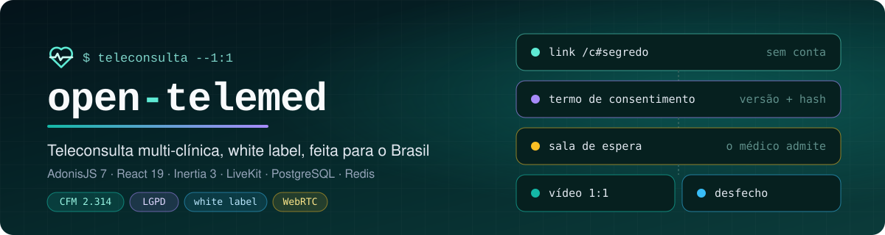
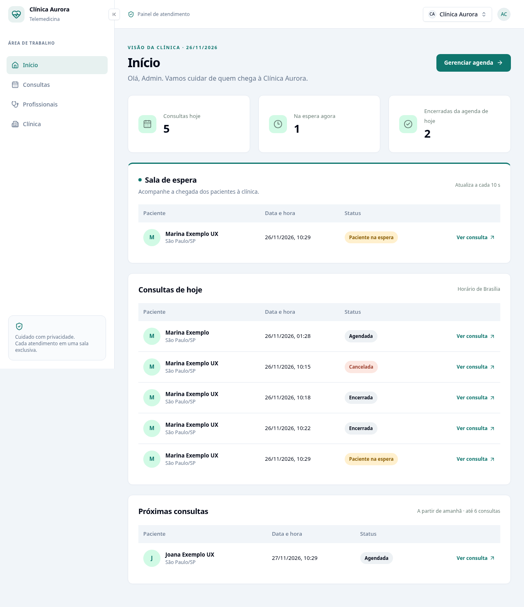
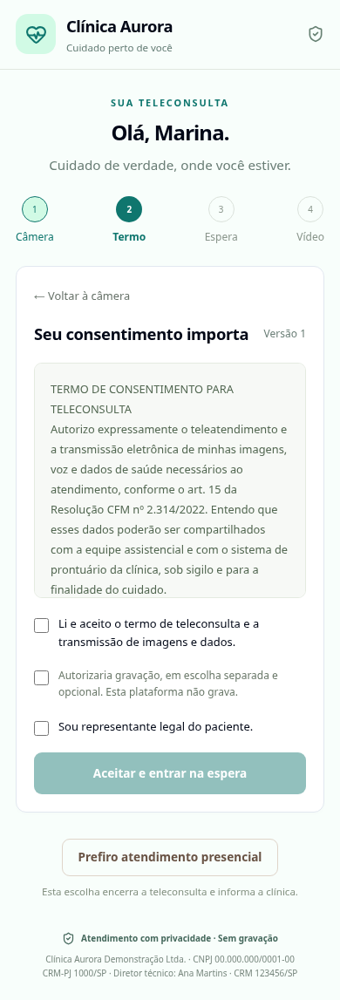
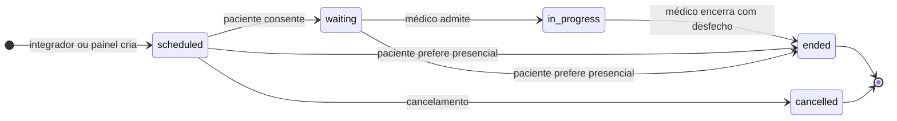

<div align="center">



<p>
  <a href="https://nodejs.org/"></a>
  <a href="https://adonisjs.com/"></a>
  <a href="https://react.dev/"></a>
  <a href="https://inertiajs.com/"></a>
  <a href="https://livekit.io/"></a>
  <a href="https://www.typescriptlang.org/"></a>
  <a href="https://tailwindcss.com/"></a>
  <a href="package.json"></a>
  <a href="#licença"></a>
</p>

[English](README.md) · **Português**

---

_"O paciente clica no link, aceita o termo e espera. O médico admite. O resto é consulta."_

<table>
  <tr>
    <td width="72%" valign="top"></td>
    <td width="28%" valign="top"></td>
  </tr>
</table>

</div>

---

> [!IMPORTANT]
> **`open-telemed` é uma plataforma de teleconsulta 1:1, multi-clínica e white label.**
> Cada clínica tem marca, domínio e dados legais próprios. O paciente entra por um link, **sem criar conta**: testa câmera
> e microfone, aceita um termo versionado, espera na sala e só entra no vídeo quando o médico o admite. O fluxo segue a
> **Resolução CFM 2.314/2022**, a **Lei 14.510/2022** e a **LGPD**. O vídeo roda no **LiveKit**, próprio ou Cloud, sem dado clínico
> passando por ele. Versão **pré-1.0** (`0.1.0`).

---

## Visão geral

O open-telemed não é um prontuário. Ele faz bem uma coisa, a sala de teleconsulta, e entrega o registro ao sistema
da clínica por API e webhook. No modo headless, o integrador controla as duas interfaces e chama o motor pelo próprio
backend; o painel do open-telemed fica para operação da plataforma.

<table>
  <tr>
    <td width="33%" valign="top"><h3>🎥 Vídeo 1:1 no LiveKit</h3>Uma sala por consulta, com no máximo duas pessoas e o prefixo da clínica no nome. O token inicial dura 60 s e só abre aquela sala. O metadata leva só o papel, e encerrar agenda o fechamento com recuperação em caso de falha.</td>
    <td width="33%" valign="top"><h3>🏥 Multi-clínica e white label</h3>A clínica é resolvida pelo <code>Host</code> e pelos domínios dela: logo, cores (inclusive no vídeo) e título próprios. O rodapé mostra razão social, CNPJ, CRM-PJ e diretor técnico.</td>
    <td width="33%" valign="top"><h3>📝 Consentimento como manda o CFM</h3>Termo imutável e versionado por clínica. O aceite grava versão, hash, data e hora, IP, user-agent e representante legal. A gravação é uma escolha separada e vem desligada.</td>
  </tr>
  <tr>
    <td valign="top"><h3>🔒 Sigilo médico</h3>Só o médico da consulta admite, pega o token de vídeo e encerra, nem o dono da clínica. O paciente não recebe token antes de consentir e ser admitido.</td>
    <td valign="top"><h3>🔌 API e webhooks</h3>O integrador cria, consulta, cancela e audita consultas com um token de serviço. Cada mudança de status sai num webhook assinado em HMAC-SHA256, com retentativas.</td>
    <td valign="top"><h3>🧪 Testado de ponta a ponta</h3>Suítes Japa (unidade, funcional e navegador) contra PostgreSQL e Redis reais. Duas sessões de vídeo de verdade, com câmera falsa. Vitest no front e asserções OpenAPI.</td>
  </tr>
</table>

| Propriedade  | Valor                                                                            |
| :----------- | :------------------------------------------------------------------------------- |
| **Pacote**   | `open-telemed` `0.1.0`                                                           |
| **Runtime**  | Node.js 24 LTS (`.nvmrc`), pnpm 11 (`packageManager`)                            |
| **Backend**  | AdonisJS 7, Lucid, VineJS, Bull Queue, `livekit-server-sdk`                      |
| **Frontend** | React 19, Inertia 3, Tailwind CSS 4, `@livekit/components-react`                 |
| **Vídeo**    | LiveKit SFU 1.13 (self-hosted) ou LiveKit Cloud, WebRTC                          |
| **Dados**    | PostgreSQL e Redis (cache, rate limit e fila)                                    |
| **API**      | Redoc em `/docs` e spec em [`docs/openapi.yaml`](docs/openapi.yaml)              |
| **Base**     | [adonis-web-kit](LICENSE-adonis-web-kit-MIT): auth, tenants N:N, RBAC, auditoria |
| **Regras**   | [`docs/brazil-telemedicine-rules.pt.md`](docs/brazil-telemedicine-rules.pt.md)   |

### A vida de uma consulta



O desfecho é um de `completed`, `referred_in_person`, `patient_declined` ou `no_show`. Cada transição vai para a trilha
de auditoria (append-only) e dispara o webhook do integrador.

### Quem faz o quê

```mermaid
sequenceDiagram
    autonumber
    participant I as Integrador
    participant OT as open-telemed
    participant P as Paciente
    participant M as Médico
    participant LK as LiveKit
    Note over I,OT: Headless: paciente e médico usam UI/backend do integrador; doctor_url é null
    I->>OT: POST /api/v1/consultations
    OT-->>I: patient_url + doctor_url
    I->>P: envia o link (WhatsApp, e-mail...)
    P->>OT: abre /c#segredo, troca por sessão anônima
    P->>OT: aceita o termo (versão + hash)
    OT-->>M: paciente na espera
    M->>OT: Admitir
    OT->>LK: cria a sala (2 pessoas)
    OT-->>P: token de 60 s, só para a sala
    OT-->>M: token de 60 s, só para a sala
    P->>LK: vídeo
    M->>LK: vídeo
    M->>OT: Encerrar + desfecho
    OT->>LK: fecha a sala (retry durável em caso de falha)
    OT-->>I: webhook assinado (status, desfecho)
```

## Início rápido

```bash
# 1. Instalar (Node.js 24 LTS e pnpm 11)
pnpm install
# 2. Ambiente e chave da aplicação
cp .env.example .env && pnpm ace generate:key
# 3. PostgreSQL, Redis, Mailpit e LiveKit
docker compose up -d postgres redis mailpit livekit
docker compose exec -T postgres createdb -U postgres open_telemed_test
# 4. Schema, duas clínicas de exemplo e o servidor com HMR
pnpm ace migration:run && pnpm ace db:seed
pnpm dev
```

O app responde em `http://localhost:3333`, e o Mailpit mostra os e-mails em `http://localhost:8026`. As portas do Compose
são PostgreSQL `5434`, Redis `6381`, SMTP `1026` e LiveKit `7880`/`7881`/`7882-udp`, para não brigar com outros
projetos na mesma máquina.

O seed cria duas clínicas fictícias, **Aurora** (verde) e **Horizonte** (roxa), cada uma com administrador, médico,
usuário de serviço e uma consulta. Ele imprime os logins, os links do paciente e os tokens de integração. A senha de
demonstração é `TelemedDemo2026!`, e os médicos são `medico@aurora.example.test` e `medico@horizonte.example.test`.

> [!NOTE]
> O LiveKit precisa anunciar um IP que o navegador alcance. Se o Docker roda em outra máquina, aponte
> `LIVEKIT_NODE_IP` e `LIVEKIT_URL` no `.env` para ela. A câmera só abre em contexto seguro: `localhost` serve no
> desenvolvimento, e qualquer outro endereço precisa de HTTPS.

> [!WARNING]
> Antes da `1.0`, as migrations descrevem uma instalação limpa. Mudança de schema vai na migration `create_*` original,
> e você recria os bancos de dev e de teste com `pnpm ace migration:fresh --force`.

## Arquitetura

O backend é organizado **por domínio**. Cada módulo vive em `app/modules/<domínio>/`, segue o fluxo controller → service
→ repository → model e registra o próprio `routes.ts`.

| Módulo                                  | O que é dele                                                                       |
| :-------------------------------------- | :--------------------------------------------------------------------------------- |
| `consultations`                         | Consulta, link do paciente, sala do médico, API do integrador e webhooks           |
| `headless`                              | Autorização médica delegada, API do paciente e mapeamentos da integração confiável |
| `consents`                              | Textos de termo versionados e os aceites                                           |
| `professionals`                         | Perfil profissional (CRM, UF e RQE) e configurações da clínica                     |
| `tenants`                               | Clínica: marca, domínios, dados legais e resolução pública pelo `Host`             |
| `audits`                                | Trilha de auditoria append-only                                                    |
| `auth`, `users`, `roles`, `permissions` | Contas, JWT, RBAC e checagem de ownership (do kit)                                 |
| `web`                                   | Páginas Inertia do painel e do paciente                                            |

O vídeo fica em `app/shared/services/video_service.ts`. Os imports usam os aliases `#modules/*` e `#shared/*`, nunca
`../../`.

### Papéis

| Papel          | Pode                                                                                                                                  |
| :------------- | :------------------------------------------------------------------------------------------------------------------------------------ |
| `clinic_owner` | Configurar marca, dados legais, termo e webhook. Cadastrar profissionais e consultas. Ver tudo da clínica, mas **não atender**        |
| `doctor`       | Ver e atender **as próprias** consultas: admitir, entrar no vídeo e encerrar                                                          |
| `integrator`   | Usar a API para criar, ler, cancelar e auditar consultas, e transportar requisições headless; token de serviço sozinho **não atende** |

## Regras brasileiras → produto

| Norma                        | O que o open-telemed faz                                                                            |
| :--------------------------- | :-------------------------------------------------------------------------------------------------- |
| CFM 2.314/2022, art. 15      | Termo explícito, versionado e com hash. Sem aceite, não há vídeo                                    |
| CFM 2.314/2022, art. 4º e 6º | O termo cita a falta de exame físico. "Prefiro presencial" e o desfecho "encaminhado ao presencial" |
| CFM 2.314/2022, art. 17      | Cada clínica guarda CNPJ, CRM-PJ e diretor técnico, mostrados na página do paciente                 |
| Lei 14.510/2022, art. 26-H   | Não bloqueia médico de outra UF                                                                     |
| Lei 13.787/2018              | `retain_until` com mínimo de 20 anos (`CLINICAL_RETENTION_YEARS`)                                   |
| LGPD, art. 11                | Minimização: o LiveKit só vê o primeiro nome e o papel, os logs não têm CPF, tenants isolados       |

A pesquisa completa, com as fontes, está em [`docs/brazil-telemedicine-rules.pt.md`](docs/brazil-telemedicine-rules.pt.md).
Isso não é parecer jurídico: antes de produção, um advogado de saúde revisa.

## API do integrador

Autentique com `Authorization: Bearer <token de serviço>`, o token de API de um usuário de serviço da clínica. Recurso
de outra clínica responde **404**. Envie o `X-Tenant-Id` mapeado; vínculo e abilities do token são verificados.

| Rota                                    | Faz                                                |
| :-------------------------------------- | :------------------------------------------------- |
| `POST /api/v1/consultations`            | Cria e devolve `patient_url` e `doctor_url`        |
| `GET /api/v1/consultations/:id`         | Registro com campos que mapeiam para o RAC da RNDS |
| `POST /api/v1/consultations/:id/cancel` | Cancela antes do atendimento                       |
| `GET /api/v1/consultations/:id/audit`   | Trilha de auditoria                                |

O registro do GET inclui `professional_snapshot` (identidade médica congelada na admissão ou decisão explícita de falta)
e `outcome_author` (autoria de médico, paciente ou sistema). É uma exportação de encontro com autoria, não documento clínico
assinado digitalmente. `video_closure` informa separadamente fechamento pending/completed, modo, tentativas e `tokens_revoked`;
conclusão clínica não comprova revogação da mídia.

A lista completa e os payloads estão no [`docs/openapi.yaml`](docs/openapi.yaml) e em `/docs`.

**Webhooks.** Cada mudança de status sai num POST JSON assinado em HMAC-SHA256 (`X-OpenTelemed-Signature`). São até 6
tentativas com backoff exponencial. Verifique sobre **`X-OpenTelemed-Timestamp + '.' + corpo bruto`**, confira o timestamp
em ±300 segundos e deduplique por `event_id` (`id` é seu alias legado). Concilie eventos fora de ordem pela `revision`
da consulta. A entrega roda na fila:

```bash
pnpm ace queue:listen --queue=consultation-webhooks
pnpm ace telemed:dispatch-webhooks   # recupera eventos que não chegaram à fila (agende)
```

O LiveKit avisa entradas e saídas em `POST /webhooks/livekit`, validado com o `WebhookReceiver`.

### Modo headless

A Clínica Fácil ou outro integrador renderiza médico e paciente **na própria interface e domínio**, sem login nem marca
do open-telemed. Seu backend intermediário (BFF) chama estas APIs; o médico mantém o login do integrador e o paciente
continua sem precisar de conta. Os endpoints do motor estão implementados; o integrador constrói sua interface/BFF.
Clínicas configuradas recebem `patient_url` do próprio frontend e `doctor_url: null`.

| Rota                                           | Faz                                                                           |
| :--------------------------------------------- | :---------------------------------------------------------------------------- |
| `POST /api/v1/headless/doctor/:id/state`       | Consulta o registro da consulta do médico responsável.                        |
| `POST /api/v1/headless/doctor/:id/admit`       | Admite paciente com consentimento e congela a identidade médica.              |
| `POST /api/v1/headless/doctor/:id/video-token` | Emite token LiveKit delimitado do médico após admissão.                       |
| `POST /api/v1/headless/doctor/:id/end`         | Encerra com desfecho assinado, registra autoria e agenda fechamento de vídeo. |
| `POST /api/v1/headless/patient/session`        | Troca segredo do link por estado do paciente e segredo opaco de sessão.       |
| `POST /api/v1/headless/patient/state`          | Consulta estado do paciente e termo de consentimento exibido.                 |
| `POST /api/v1/headless/patient/consent`        | Registra consentimento explícito versionado e entra na espera.                |
| `POST /api/v1/headless/patient/video-token`    | Emite token LiveKit delimitado do paciente após consentimento e admissão.     |
| `POST /api/v1/headless/patient/decline`        | Registra recusa do paciente e agenda fechamento de vídeo.                     |

Todas as chamadas exigem token de serviço da clínica configurada, `X-Tenant-Id` e ability/permissão correspondente
`consultations.headless_doctor` ou `consultations.headless_patient`. Cada ação médica também envia `{assertion}`:
**JWT RS256 de uso único, válido por ≤60 segundos**, vinculado ao médico mapeado (`sub`), consulta e ação, com `iss`,
`aud: telemed:doctor-action`, `jti`, `iat` e `exp`. Em `end`, o desfecho também é assinado. O motor fixa emissor/chave pública,
consome o nonce atomicamente e revalida vínculo e permissões do médico responsável; gestor ou conta de serviço não podem
impersoná-lo.

Chamadas do paciente após `/session` exigem `?consultation_id=...` e `X-Patient-Session`. Mantenha o segredo da sessão do
motor no servidor, protegido por cookie HttpOnly; nunca exponha credenciais de serviço ou asserções médicas ao navegador.
O consentimento também leva evidências verificadas de `client_ip` e `client_user_agent`. O integrador pode usar
`@livekit/components-react` com os tokens recebidos dentro do próprio layout.

Configure o backend confiável e o mapeamento médico verificado pelos comandos operacionais (valores ilustrativos):

```bash
pnpm ace permission:sync
pnpm ace telemed:configure-headless --tenant-id=7 --service-user-id=20 --issuer=clinicafacil-unit-7 --public-key-file=clinic-public.pem --patient-url=https://clinic.example/teleconsulta
pnpm ace telemed:map-doctor --tenant-id=7 --professional-id=42 --subject=doctor-314
pnpm ace telemed:prune-assertions   # agende a limpeza de marcadores de replay expirados
pnpm ace telemed:close-videos      # repita fechamentos pendentes a cada minuto
```

LiveKit Cloud com cutoff explícito é recomendado para revogar tokens ao encerrar. No modo `self_hosted`, fechar a sala
não revoga tokens em cache e `tokens_revoked` permanece false. A imposição real no Cloud ainda exige qualificação da
implantação. Consulte o [contrato de integração](docs/clinicafacil-integration.pt.md) e o [relatório headless](docs/headless-report.pt.md).

## Configuração

Todas as variáveis são validadas no boot por [`start/env.ts`](start/env.ts). As próprias do open-telemed:

| Variável                                               | Para quê                                                                                          |
| :----------------------------------------------------- | :------------------------------------------------------------------------------------------------ |
| `LIVEKIT_URL`, `LIVEKIT_API_KEY`, `LIVEKIT_API_SECRET` | Servidor LiveKit e credenciais para emitir tokens                                                 |
| `LIVEKIT_REVOCATION_MODE`                              | `self_hosted` (padrão): apenas fechamento; `cloud`: revogação explícita de tokens antes de fechar |
| `LIVEKIT_NODE_IP`                                      | IP que o LiveKit anuncia aos navegadores (Compose)                                                |
| `PLATFORM_HOSTS`                                       | Hosts da plataforma. Os domínios de cada clínica ficam no banco                                   |
| `TRUST_PROXY`                                          | Só com proxy controlado: libera o `X-Forwarded-Host`                                              |
| `CLINICAL_RETENTION_YEARS`                             | Retenção mínima do registro clínico (padrão 20)                                                   |
| `WEBHOOK_ALLOWED_ORIGINS`                              | Origens de webhook liberadas pelo operador (a clínica não libera)                                 |
| `REGISTRATION_WORKSPACE_MODE`                          | `none`: clínica e médico entram por convite ou pelo administrador                                 |

As do kit (`APP_*`, segredos de token, `DB_*`, `REDIS_*`, `SMTP_*`) seguem o [adonis-web-kit](LICENSE-adonis-web-kit-MIT).

> [!CAUTION]
> `devkey`/`secret` do LiveKit e os placeholders do `docker-compose.yml` são de desenvolvimento. Em produção, use
> segredos longos e independentes, LiveKit fora do modo `--dev`, HTTPS/WSS e um servidor TURN para quem está atrás de
> NAT de operadora.

## Comandos e testes

```bash
pnpm dev              # servidor com HMR
pnpm build            # build de produção
pnpm lint             # ESLint
pnpm typecheck        # backend e inertia/
pnpm test:e2e         # Japa: unidade, funcional e navegador
pnpm test:ui          # Vitest do front
```

| Suíte         | Onde                        | O que prova                                                        |
| :------------ | :-------------------------- | :----------------------------------------------------------------- |
| **funcional** | `tests/functional/telemed/` | Isolamento entre clínicas, consentimento, sigilo, webhooks, `Host` |
| **navegador** | `tests/browser/telemed/`    | Paciente consente → espera → médico admite → os dois se veem       |
| **front**     | `inertia/tests/telemed/`    | Termo, etapas do paciente, controles por papel                     |

Último portão registrado: **279 testes backend/browser** e **70 testes de frontend em 15 arquivos**, com lint, typecheck e
build aprovados ([relatório headless](docs/headless-report.pt.md)).

As suítes de backend **zeram** o banco e o Redis de teste: aponte o `.env.test` para instâncias descartáveis. A suíte
de navegador precisa do Chromium do Playwright (`pnpm exec playwright install chromium`).

## Fora desta versão

Gravação, receita e atestado com ICP-Brasil, FHIR/RNDS, validação do CRM no CFM e app mobile. O desenho da integração
com o primeiro integrador está em [`docs/clinicafacil-integration.pt.md`](docs/clinicafacil-integration.pt.md).

## Licença

O código do open-telemed é **AGPL-3.0-only** ([`LICENSE`](LICENSE)). Parte dele vem do
[adonis-web-kit](LICENSE-adonis-web-kit-MIT), sob MIT.

> [!WARNING]
> O layout do painel deriva do **Metronic v9.5.0**, que tem licença comercial e **não** é coberto pela AGPL. Os arquivos
> estão listados no [`NOTICE`](NOTICE), em `inertia/components/metronic/` e `inertia/css/metronic/`. Enquanto eles
> existirem, este repositório não pode ser publicado como open source.

---

<div align="center">

**open-telemed · Gabriel Maia · 2026**

_Teleconsulta com sigilo, uma clínica de cada vez._


</div>
